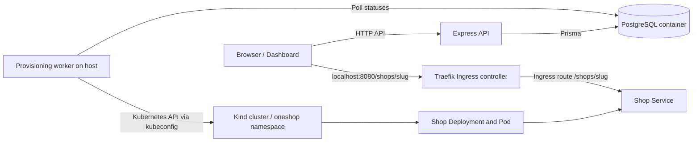

# OneShop project file and architecture guide

This guide is a revision map for the current repository. It explains the main source files, configuration, Kubernetes YAML, and the path a shop request takes through the system.

## What the project does

OneShop is a small shop hosting platform. A user signs in, creates a shop, and sees its provisioning status in the web dashboard. The API stores the shop record in PostgreSQL with status `PROVISIONING`. A separate worker watches that database, creates Kubernetes resources for the shop, and changes the record to `READY` when its Deployment is available. Traefik routes browser traffic to the shop.

## Architecture flow

### Create and serve a shop

1. The dashboard in `apps/web/src/app/shops/page.tsx` sends a create request to the API.
2. The API validates the input, associates the shop with the signed-in user, and inserts the shop with status `PROVISIONING`.
3. The dashboard periodically reloads active shops, so the user sees changes without refreshing manually.
4. `apps/worker/src/index.ts` polls PostgreSQL. For each `PROVISIONING` or `UPDATING` shop, it reconciles a Deployment, Service, and Ingress named `shop-<shop-id>` in namespace `oneshop`.
5. Kubernetes starts the `oneshop/shop:local` container. Its readiness probe calls `/health` on port 3000.
6. When the Deployment rollout is available, the worker changes the database status to `READY`.
7. A request to `http://localhost:8080/shops/<slug>` reaches Traefik, which matches the Ingress path and sends it to the shop Service and Pod. Configure `PLATFORM_URL=http://localhost:8080` for the API so the URL saved for each shop includes the mapped port.

### Update and delete

An update changes the database record to `UPDATING`; the worker applies the changed shop settings and waits for the updated Deployment to be available before marking it ready. A delete request changes status to `DELETING`; the worker deletes that shop's Ingress, Service, and Deployment, then removes the database row. If an operation fails, the worker sets `ERROR` and saves the failed operation in `retryStatus`. The authenticated `POST /api/shops/:id/retry` endpoint restores that operation's status, and the dashboard's Retry button calls it. This lets a failed delete retry cleanup, for example, instead of starting provisioning again.

## Kubernetes and infrastructure YAML files

| File | What it configures |
| --- | --- |
| `infra/kind/cluster.yaml` | The local kind cluster named `oneshop`. Its control plane maps host ports `8080` and `8443` to node ports `30080` and `30443`. These mappings are applied when the cluster is created. |
| `infra/kubernetes/namespace.yaml` | The `oneshop` namespace, which keeps platform-managed shop workloads and worker permissions grouped together. |
| `infra/kubernetes/worker-rbac.yaml` | The `oneshop-worker` ServiceAccount, namespace Role, and RoleBinding. The Role permits get/list/create/update/patch/delete on Deployments, Services, and Ingresses in `oneshop`. The current development worker runs on the host with kubeconfig; this identity is for in-cluster operation. |
| `infra/kubernetes/traefik-values.yaml` | Helm values for Traefik: enables/defaults the `traefik` IngressClass, enables Kubernetes Ingress watching, uses NodePort, and binds service NodePorts 30080 and 30443. |
| `docker-compose.yml` | The local Postgres 17 container, credentials/database defaults, host port, persistent named volume, restart behavior, and readiness health check. |

The per-shop Deployment, Service, and Ingress are not checked-in YAML files. The provisioning worker builds those Kubernetes objects in code from each shop's database fields.

## Repository file map

### Root files

| Path | Purpose |
| --- | --- |
| `package.json` | npm workspace definition and shared commands for development, type checks, build, and lint. |
| `package-lock.json` | Locked npm dependency versions for reproducible installs. |
| `tsconfig.base.json` | Shared TypeScript compiler defaults. |
| `.env.example` | Example local database and platform settings. Copy values into the app-specific environment files as needed; do not commit real secrets. |
| `.env` | Root-local environment values when present. Treat as secret and keep out of version control. |
| `docker-compose.yml` | Local PostgreSQL service and persistent storage definition. |
| `Plan.md` | Earlier project plan and goals. |
| `NEXT_IMPLEMENTATION_PLAN.md` | The sequenced implementation work plan. |
| `PROJECT_STATUS.md` | Snapshot of completed work and current project state. |
| `LOCAL_CHECK_COMMANDS.md` | Copy/paste PowerShell commands for running and inspecting the local stack. |
| `PROJECT_FILE_GUIDE.md` | This architecture and file revision guide. |

### Web app: `apps/web`

| Path | Purpose |
| --- | --- |
| `apps/web/src/app/page.tsx` | Main landing page. |
| `apps/web/src/app/shops/page.tsx` | Shop dashboard UI: list/create/update/delete shops, display lifecycle status, retry errors, and link to storefront editing. |
| `apps/web/src/app/shops/[id]/storefront/page.tsx` | Owner editor for shop tagline, description, announcement, accent color, and product cards. Saves content through the authenticated API and watches publish status. |
| `apps/web/src/app/layout.tsx` | Shared Next.js document layout. |
| `apps/web/src/app/globals.css` | Global styles. |
| `apps/web/next.config.ts` | Next.js configuration. |
| `apps/web/package.json` | Web workspace dependencies and scripts. |
| `apps/web/tsconfig.json` | Web TypeScript settings. |
| `apps/web/eslint.config.mjs` | Web lint configuration. |

### API: `apps/api`

| Path | Purpose |
| --- | --- |
| `apps/api/src/index.ts` | Express app entry point. Adds JSON parsing, mounts auth and shop routers, health/root endpoints, and the final error handler. |
| `apps/api/src/routes/auth.ts` | Auth URL/method definitions and authentication middleware wiring. |
| `apps/api/src/routes/shops.ts` | Shop URL/method definitions, protected by authentication, including retry for failed shop operations. |
| `apps/api/src/controllers/auth.controller.ts` | Handles auth requests and HTTP responses. |
| `apps/api/src/controllers/shops.controller.ts` | Validates shop request input, calls shop services, and shapes HTTP responses. |
| `apps/api/src/services/auth.service.ts` | Authentication business logic such as registration, sign-in, and password verification. |
| `apps/api/src/services/shop.service.ts` | Shop business logic and database operations, including status transitions and URL construction. |
| `apps/api/src/middleware/auth.ts` | Reads and checks the session cookie, then attaches the authenticated user to the request. |
| `apps/api/src/middleware/error-handler.ts` | Converts thrown application errors into HTTP error responses. |
| `apps/api/src/lib/app-error.ts` | Application error type carrying an HTTP status. |
| `apps/api/src/lib/prisma.ts` | Prisma client setup and PostgreSQL adapter. |
| `apps/api/src/types.ts` | Shared Express request type extensions. |
| `apps/api/prisma/schema.prisma` | Database model definitions: User, Shop, ShopStatus, persisted JSON storefront content, uniqueness and indexes. |
| `apps/api/prisma/migrations/` | SQL history used to evolve the database schema. |
| `apps/api/prisma7.config.ts` | Prisma CLI datasource configuration from environment variables. |
| `apps/api/package.json` | API dependencies and development/Prisma commands. |
| `apps/api/tsconfig.json` | API TypeScript settings. |

Typical API request flow is **route → controller → service → Prisma/database → controller response**. Routes declare endpoints; controllers translate HTTP input/output; services hold application rules and persistence behavior.

### Provisioning worker: `apps/worker`

| Path | Purpose |
| --- | --- |
| `apps/worker/src/index.ts` | Polls PostgreSQL for `PROVISIONING`, `UPDATING`, and `DELETING` shops. Creates or updates their Kubernetes Deployment, Service, and Ingress; checks rollout readiness; updates or deletes database records. Failed operations are marked `ERROR` while their operation type is retained so the owner can retry the same operation. |
| `apps/worker/package.json` | Worker dependencies (`@kubernetes/client-node`, `pg`) and development/typecheck scripts. |
| `apps/worker/tsconfig.json` | Worker TypeScript settings. |
| `apps/worker/.env` | Local worker settings when present. It must point at the same database as the API and specify the cluster namespace/image/host as needed. Keep it private. |

The worker is currently a host process started by npm, not a Kubernetes Deployment. It uses the current kubeconfig context to talk to kind.

### Shop runtime: `apps/shop`

| Path | Purpose |
| --- | --- |
| `apps/shop/server.js` | HTTP shop server. Renders the shop name and persisted `SHOP_CONTENT_JSON` fields/products; exposes `/health` for Kubernetes probes. |
| `apps/shop/Dockerfile` | Builds the minimal Node 22 Alpine image, runs it as a non-root user, and exposes port 3000. |

### Local cluster guide and helper script

| Path | Purpose |
| --- | --- |
| `infra/kind/README.md` | Setup instructions for kind, Traefik, loading the shop image, starting the app, and inspecting resources. |
| `scripts/dev-all.mjs` | Starts web, API, and worker development processes together and manages their process lifecycle. |

## Main runtime status values

| Status | Meaning |
| --- | --- |
| `PROVISIONING` | Database record exists; the worker is creating the Kubernetes resources and starting the first Deployment. |
| `READY` | Deployment has passed the worker's rollout readiness checks. |
| `UPDATING` | Shop fields changed; worker is reconciling Kubernetes resources. |
| `DELETING` | Deletion was requested; worker is removing Kubernetes objects, then the database record. |
| `ERROR` | Worker hit an error while reconciling. Check worker output and Kubernetes events/pod descriptions. |

## Useful mental model

- **PostgreSQL is the desired state ledger.** It records what shops should exist and their lifecycle status.
- **The worker is the reconciler.** It compares each pending database record with the Kubernetes objects it should have and applies changes.
- **Kubernetes runs each shop.** A Deployment maintains the Pod, a Service gives it a stable in-cluster address, and an Ingress describes the public route.
- **Traefik handles incoming shop traffic.** It reads Ingress rules and forwards matching host/path requests to the matching Service.
- **The dashboard reflects progress.** It reads shop records from the API and refreshes while a shop is in an active lifecycle state.
