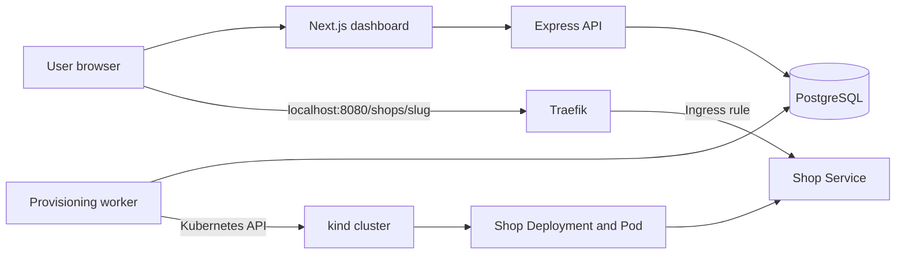

# OneShop Platform

OneShop is a local shop hosting platform. Users can register, create shops, and watch each shop move from provisioning to ready. The API stores shop state in PostgreSQL, a provisioning worker turns that state into Kubernetes resources, and Traefik routes requests to the running shop.

> **Project status:** This is an active local development project. The shop runtime is currently a small sample storefront. The provisioning worker currently runs on the developer machine and uses the active kubeconfig context to manage a local kind cluster.

## Features

- User registration, login, logout, and cookie-based sessions
- Shop create, list, update, status, and delete API operations
- PostgreSQL persistence with Prisma migrations
- Automatic shop provisioning and deletion through a polling worker
- Per-shop Kubernetes Deployment, Service, and Ingress
- Local kind cluster with Traefik ingress
- Dashboard status refresh while shops are provisioning, updating, or deleting

## Architecture



When a shop is created, the API records it as `PROVISIONING`. The worker polls for pending shops and creates a Deployment, Service, and Ingress in the `oneshop` namespace. Kubernetes starts the shop container and checks its `/health` endpoint. Once the Deployment is available, the worker marks the database record `READY`; the dashboard refreshes and displays the shop URL.

## Technology

- **Web:** Next.js and React
- **API:** Express, TypeScript, Zod
- **Data:** PostgreSQL, Prisma, `pg`
- **Provisioning:** Node.js worker and Kubernetes client
- **Local Kubernetes:** kind, kubectl, Helm, Traefik
- **Shop runtime:** Node.js HTTP server in a Docker image

## Prerequisites

- Node.js 22 or newer and npm
- Docker Desktop using the Linux container engine
- kind, kubectl, and Helm

## Run locally

Commands below use PowerShell from the repository root.

### 1. Install dependencies and configure environment

```powershell
npm install
Copy-Item .env.example apps/api/.env
Copy-Item .env.example apps/worker/.env
```

Use matching `DATABASE_URL` and `DIRECT_URL` values in both app environment files. The provided example connects to the local Postgres container. Change `SESSION_SECRET` to a random value at least 32 characters long before using the app beyond local development. Set `PLATFORM_URL=http://localhost:8080` in `apps/api/.env` so shop links use the local kind port mapping.

Create `apps/web/.env.local` with:

```dotenv
API_URL=http://localhost:4000
```

### 2. Start PostgreSQL and migrate the database

```powershell
docker compose up -d postgres
npm --workspace @oneshop/api run prisma:generate
npm --workspace @oneshop/api run prisma:migrate:dev
```

### 3. Create the local Kubernetes cluster

```powershell
kind create cluster --name oneshop --config infra/kind/cluster.yaml --wait 90s
kubectl apply -f infra/kubernetes/namespace.yaml
kubectl apply -f infra/kubernetes/worker-rbac.yaml
```

Install Traefik into the cluster:

```powershell
helm repo add traefik https://traefik.github.io/charts
helm repo update
helm upgrade --install traefik traefik/traefik `
  --namespace traefik `
  --create-namespace `
  --values infra/kubernetes/traefik-values.yaml
kubectl rollout status deployment/traefik -n traefik --timeout=180s
```

The kind configuration forwards host ports `8080` and `8443` to Traefik's HTTP and HTTPS node ports. These mappings are set when the cluster is created.

### 4. Build and load the shop image

```powershell
docker build -t oneshop/shop:local -f apps/shop/Dockerfile apps/shop
kind load docker-image oneshop/shop:local --name oneshop
```

The worker reads the current kubeconfig context. Confirm it points to the local cluster:

```powershell
kubectl config current-context
```

Expected context: `kind-oneshop`.

### 5. Start the application

```powershell
npm run dev:all
```

This starts the dashboard, API, and worker. Open [http://localhost:3000](http://localhost:3000), register an account, and create a shop. Once ready, its sample storefront should be available at `http://localhost:8080/shops/<slug>`.

To stop the application, press `Ctrl+C` in the terminal. Stop Postgres while preserving its data with `docker compose stop postgres`.

## Useful commands

```powershell
# Check cluster and platform resources
kubectl get nodes
kubectl get pods -n traefik
kubectl get deployments,services,ingresses,pods -n oneshop -o wide

# Check API health
Invoke-RestMethod http://localhost:4000/health

# Run TypeScript checks for the existing applications
npm run typecheck:api
npm run typecheck:worker
npm run typecheck:web
```

For more commands to diagnose shops and Kubernetes resources, see [LOCAL_CHECK_COMMANDS.md](LOCAL_CHECK_COMMANDS.md). For explanations of the repository files, YAML resources, and lifecycle flow, see [PROJECT_FILE_GUIDE.md](PROJECT_FILE_GUIDE.md). The detailed kind setup is in [infra/kind/README.md](infra/kind/README.md).

## Shop lifecycle

| Status | Meaning |
| --- | --- |
| `PROVISIONING` | The worker is creating the shop's Kubernetes resources and waiting for its Deployment. |
| `READY` | The shop Deployment is available. |
| `UPDATING` | The worker is applying changed shop settings. |
| `DELETING` | The worker is removing the shop's Kubernetes resources and database record. |
| `ERROR` | Provisioning failed. Inspect worker output and Kubernetes events. |

## Project layout

```text
apps/
  api/       Express API, Prisma schema and migrations
  shop/      Containerized sample shop server
  web/       Next.js dashboard
  worker/    Database polling and Kubernetes reconciliation
infra/
  kind/      Local kind cluster configuration and setup guide
  kubernetes/Namespace, worker RBAC, and Traefik Helm values
scripts/     Local development process launcher
```

## Cleanup

Delete the kind cluster and its resources with:

```powershell
kind delete cluster --name oneshop
```

Postgres data is stored in the named `postgres-data` Docker volume and remains when you run `docker compose down`. To remove the database data too, use `docker compose down --volumes`.
